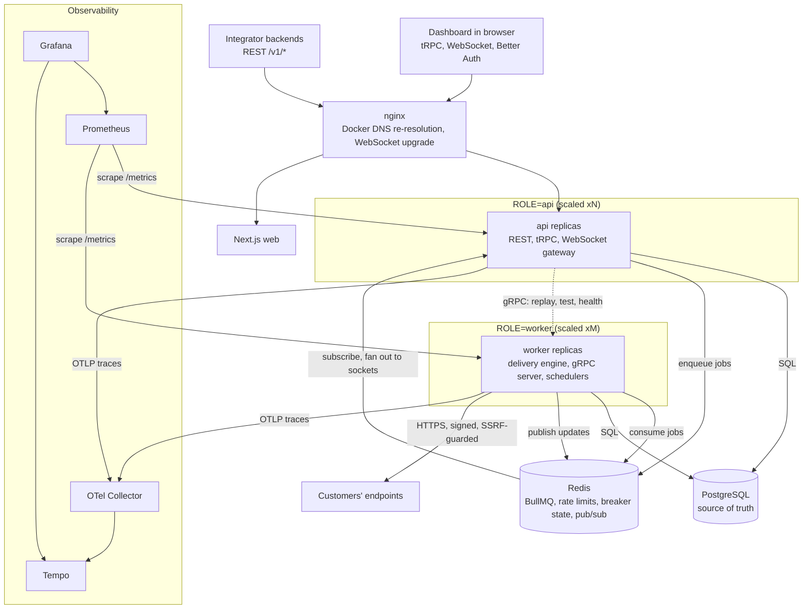
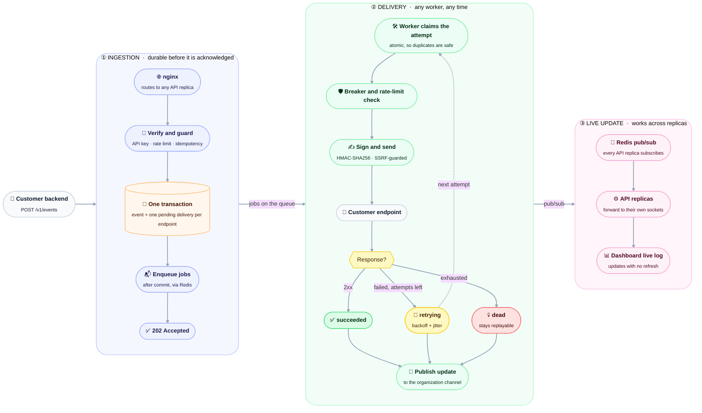
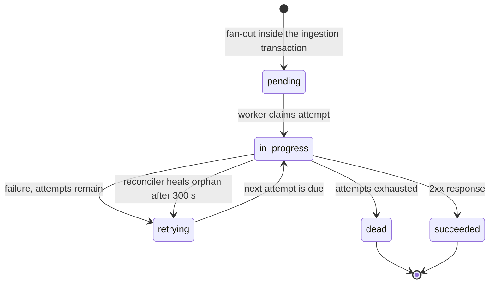
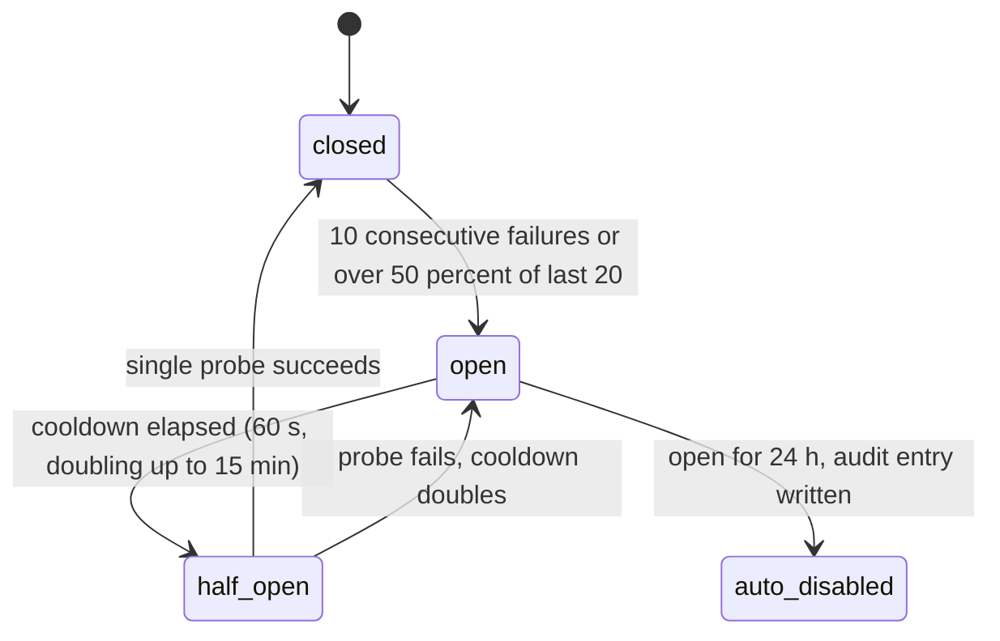

# Hookline

> Reliable webhook delivery infrastructure: signed payloads, smart retries, circuit breaking, live delivery logs, and one-click replay.


**v1.0.0** · TypeScript · NestJS + Fastify · Next.js · PostgreSQL · Redis + BullMQ · gRPC · WebSocket · Docker · OpenTelemetry

---

## What is Hookline?

A **webhook** is an HTTP request one system sends to another when something happens, for example "invoice paid" or "order shipped". Sending them reliably is surprisingly hard, and most teams end up rebuilding the same machinery.

Hookline is that machinery as a platform. Say you run an invoicing SaaS and your customers want to be notified when an invoice is paid. You send **one event** to the Hookline API. Hookline then:

1. **Fans it out** to every endpoint that subscribed to that event type.
2. **Signs** each payload so the receiver can verify it really came from you.
3. **Delivers** it, and **retries** failures with exponential backoff and jitter.
4. **Protects** struggling servers with a per-endpoint circuit breaker, and protects itself from malicious URLs with SSRF defenses.
5. **Records every attempt**, so you can see exactly what was sent and what came back in a **real-time dashboard**, and **replay** anything with one click.

It is multi-tenant, horizontally scalable, and observable by default. It follows the same idea as services like Svix and Hookdeck, built end to end as a full-stack distributed systems project.

## Why webhooks are hard

A customer's server goes down. A deploy kills a worker in the middle of a request. A retry storm hammers an endpoint that is already failing. Someone registers `http://169.254.169.254` as a webhook URL to reach cloud credentials. Support asks "did we actually send it?" and nobody can answer. Hookline is built around those failure modes, and the project's tests and chaos runs target them directly.

## At a glance

|                   |                                                                                                                                                              |
| ----------------- | ------------------------------------------------------------------------------------------------------------------------------------------------------------ |
| **Reliability**   | 4 containers `SIGKILL`ed under load: **1,645 of 1,645 accepted events accounted for, 0 lost**                                                                |
| **Testing**       | 53 unit, 112 integration (real Postgres and Redis, no mocks), 5 Playwright end-to-end tests                                                                  |
| **Coverage**      | **94.4% line coverage** on core modules, enforced by thresholds that fail the build                                                                          |
| **Security**      | SSRF defense at three layers, HMAC-signed payloads, encrypted secrets, hashed API keys, cross-tenant isolation tested across REST, tRPC, WebSocket, and gRPC |
| **Observability** | One distributed trace across API, queue, and worker; Prometheus metrics; four provisioned Grafana dashboards; alert rules                                    |
| **Try it**        | `pnpm demo` runs everything, including the chaos test, in one command                                                                                        |

## Features

- **Reliable delivery**: at-least-once semantics, exponential backoff with jitter (8 attempts over about 31 hours), and a dead-letter state whose deliveries stay replayable
- **Signed payloads**: HMAC-SHA256 signatures over `timestamp.body`, replay-protection timestamps, and zero-downtime secret rotation with dual signatures
- **Circuit breaker**: per-endpoint protection that stops hammering failing servers, with half-open probes and auto-disable after 24 hours open
- **SSRF protection**: URL validation at creation, a pre-flight IP check, and a connect-time DNS guard that blocks loopback, private, link-local, and cloud-metadata addresses
- **Live delivery log**: a WebSocket-powered dashboard with a per-attempt request and response inspector, pause and resume, and automatic backfill after reconnects
- **Replay**: re-send any delivery or event with one click, or replay all dead deliveries in bulk
- **Idempotent ingestion**: safe client retries through the `Idempotency-Key` header
- **Multi-tenant**: organizations, members, roles (owner, admin, member), optional TOTP two-factor authentication, hashed and scoped API keys, and an audit log
- **Rate limiting**: per-API-key ingestion limits and per-endpoint outbound limits
- **Analytics**: volume, success rate, latency percentiles (p50, p95, p99), and per-endpoint health
- **Observability**: OpenTelemetry traces, Prometheus metrics, Grafana dashboards as code, and structured logs with trace IDs
- **Horizontally scalable**: stateless API and worker replicas behind nginx, with Redis pub/sub fan-out so live updates work from any replica

## Try it in one command

```bash
pnpm install
cp .env.example .env     # fill in secrets (generation commands are in the file)
pnpm demo
```

`pnpm demo` starts the full topology behind nginx (3 API replicas, 2 workers, Postgres, Redis, Prometheus, Grafana, Tempo), registers a healthy and a failing endpoint, streams the live log, replays a delivery, then **kills containers under load and verifies that no event was lost**. It exits non-zero if any step fails. Requires Node 24, pnpm, and Docker.

---

## Architecture at a glance



Hookline is a **modular monolith**: one codebase and one Docker image, started with a `ROLE` (`api`, `worker`, or `all`). Details are in [ARCHITECTURE.md](./ARCHITECTURE.md).



## How it stays reliable

Every delivery moves through a small state machine, and every endpoint has its own circuit breaker.

### Delivery lifecycle

<!-- keep in sync with ARCHITECTURE.md section 5.2 and DATA.md section 3 -->



A `dead` delivery stays replayable. Replaying creates a new linked delivery instead of changing the old one.

### Circuit breaker

<!-- keep in sync with ARCHITECTURE.md section 6.3 -->



A failing endpoint stops receiving traffic until a single probe succeeds, so Hookline never hammers a server that is already down.

## Tech stack

| Area          | Technology                                                                                                                             |
| ------------- | -------------------------------------------------------------------------------------------------------------------------------------- |
| Frontend      | Next.js, React, TypeScript, Tailwind CSS, shadcn/ui + Radix, TanStack Query and Table, Zustand, React Hook Form, Zod, Recharts, Motion |
| Backend       | Node.js, NestJS + Fastify adapter, TypeScript, Zod                                                                                     |
| APIs          | REST + OpenAPI (public), tRPC (dashboard), gRPC + Protobuf (internal), WebSocket (live updates)                                        |
| Data          | PostgreSQL, Drizzle ORM, Redis                                                                                                         |
| Queue         | BullMQ                                                                                                                                 |
| Auth          | Better Auth (dashboard, organizations, roles, 2FA), custom hashed API keys (public API)                                                |
| Observability | Pino, OpenTelemetry, Prometheus, Grafana, Tempo                                                                                        |
| Infra         | Docker, Docker Compose, nginx                                                                                                          |
| Testing       | Vitest, Testcontainers, Playwright, axe-core, k6                                                                                       |
| Tooling       | pnpm workspaces, Turborepo, ESLint, Prettier, Husky, commitlint, GitHub Actions, gitleaks, Dependabot                                  |

## Repository structure

```text
hookline/
├── apps/
│   ├── web/                # Next.js dashboard
│   └── server/             # NestJS app (ROLE=api | worker | all)
├── packages/
│   ├── shared/             # Zod schemas, types, constants
│   ├── proto/              # .proto files + generated code
│   └── config/             # shared tsconfig / eslint / prettier
├── infra/
│   ├── docker/             # Dockerfiles
│   ├── nginx/              # nginx.conf
│   ├── prometheus/         # prometheus.yml
│   └── grafana/            # provisioning + dashboards
├── docker-compose.dev.yml  # postgres + redis for local dev
├── docker-compose.yml      # full demo topology
├── README.md  PRD.md  PHASES.md  ARCHITECTURE.md
├── DATA.md  API.md  AGENTS.md  LOGS.md
└── turbo.json  pnpm-workspace.yaml
```

## Getting started

### Prerequisites

- Node.js (current LTS, see `.nvmrc`)
- pnpm
- Docker + Docker Compose

### Setup

```bash
git clone <repo-url> hookline && cd hookline
pnpm install
cp .env.example .env            # then fill in secrets
docker compose -f docker-compose.dev.yml up -d   # postgres + redis
pnpm db:migrate
pnpm dev                        # API on :4000, dashboard on :3100
```

Then open the dashboard at **http://localhost:3100**. The web app reaches the
API through same-origin paths (`/trpc` and `/api/auth` are rewritten by
Next.js to `API_ORIGIN`, default `http://localhost:4000`), so session cookies
work without CORS. The live log connects its WebSocket directly to the API
(`NEXT_PUBLIC_WS_URL`, default `ws://localhost:4000/ws` — cookies are shared
across localhost ports). Port 3100 is used because 3000 is commonly taken; change
it via the `dev` script in `apps/web/package.json` and keep
`AUTH_TRUSTED_ORIGINS` in `.env` in sync (Better Auth rejects POSTs from
untrusted origins).

> Dev Postgres and Redis publish on host ports **15432** and **16379**
> (`POSTGRES_PORT` / `REDIS_PORT` in `.env`) to avoid conflicts with native
> services on 5432/6379. `DATABASE_URL` and `REDIS_URL` in `.env` already
> point there.

### Observability stack (Phase 12)

The collector, Tempo, Prometheus (with alert rules), Grafana and the
Postgres/Redis exporters are provisioned as code under `infra/`:

```bash
# Canonical stack (expects the Phase 13 compose network: api/worker/postgres/redis)
docker compose -f infra/docker-compose.observability.yml up -d

# Local verification against host processes + the dev compose (run once,
# verified 2026-10-25: Prometheus scraped api+worker, all 4 dashboards and
# both datasources provisioned in Grafana, traces reached Tempo)
HOOKLINE_PG_PASSWORD=<from .env> \
  docker compose -f infra/docker-compose.observability.yml \
                 -f infra/docker-compose.observability.local.yml up -d
```

Grafana lands at `http://localhost:3001` (admin password from
`GRAFANA_ADMIN_PASSWORD`, default `admin`), Prometheus at `http://localhost:9090`,
Tempo at `http://localhost:3200`. Dashboards: Hookline API, Delivery Engine,
Queues, Infrastructure.

```bash
pnpm check:dashboards   # fails if a dashboard references an unregistered metric
# Validate Prometheus config + alert rules without installing anything:
MSYS_NO_PATHCONV=1 docker run --rm --entrypoint promtool \
  -v "$(pwd)/infra:/etc/prometheus:ro" prom/prometheus:v3.4.0 \
  check config //etc/prometheus/prometheus.yml
```

The api serves `/metrics` on `PORT`; a worker role serves `/metrics` on its own
`PORT` via a standalone HTTP server. Traces are exported over OTLP when
`OTEL_EXPORTER_OTLP_ENDPOINT` is set (unset = dropped, no outbound calls).

### Testing & CI (Phase 14)

Coverage is enforced, not decorative: `pnpm test:cov` runs unit + integration
with V8 coverage and fails below **90% lines** overall on the core modules,
with per-file floors of 100% for signing and the auth/API-key guards, 95% for
RolesGuard, and 90% for the breaker, delivery processor, and events service
(idempotency). Measured on the full suite: **94.4% lines** across the included
core modules (2026-10-28, see LOGS.md Run 016).

Security suites run with the production posture (`ALLOW_INSECURE_ENDPOINTS`
off): connect-time SSRF blocks loopback/private/link-local/metadata targets,
IPv6 and IPv4-mapped literals, alternate IPv4 spellings, and hostnames that
resolve privately — proven through every outbound path (test send, delivery
processor, replay). An authorization matrix covers REST, tRPC, WebSocket and
internal gRPC in one place (`apps/server/test/int/authz-matrix.spec.ts`).

GitHub Actions workflows live in `.github/` (lint, typecheck, unit,
integration with Testcontainers, build, Playwright E2E, Docker image build
tagged by commit and version, Dependabot, gitleaks secret scanning, and a
`pnpm audit` gate at high severity). They are syntax-validated only — nothing
in this project has executed them remotely (LOGS.md Run 016).

### Run the full demo topology (Phase 13, verified)

```bash
docker compose -f docker-compose.dev.yml down   # free the shared project name/volumes
docker compose up --build -d --scale api=3 --scale worker=2
```

Dashboard `http://localhost:8080` (nginx edge), Grafana `http://localhost:3001`
(default admin password unless `GRAFANA_ADMIN_PASSWORD` was set when the
containers were created), Prometheus `http://localhost:9090`. The one-shot
`migrate` service applies migrations before the apps start; nginx re-resolves
api/worker replicas per request (Docker DNS) so killed replicas are routed
around within ~5s.

**Chaos demo (zero lost events, run 2026-10-26 on 12 CPU / 7.6 GB host,
3 api + 2 worker replicas). Caveat: the load generator and the system under
test share one laptop, so throughput numbers are conservative — the demo
proves correctness under kills, not peak capacity:**

```bash
node scripts/chaos/run-chaos.mjs --duration 150 --kills 4 --tracked-rate 4 --k6-rate 40
```

Latest actual run: 4 random api/worker containers SIGKILLed during
~2.5 min of load (k6 mixed workload 40 r/s + tracked stream). Result —
accepted events 1645/1645 accounted for (464 tracked + 1181 k6), 464/464
tracked deliveries succeeded, 0 non-terminal, 0 dead after drain, k6
99.97% checks passed (the 1 failure was a request in flight to a killed
replica), WebSocket stayed live through nginx with 3290 envelopes received.
This run also exposed and fixed a real gap: deliveries orphaned in
`in_progress` by a worker SIGKILL are now healed by the reconciler
(`requeueOrphanedInProgress`, regression-tested in
`apps/server/test/int/resilience.spec.ts`).

A repeat via `pnpm demo` on 2026-10-28 (same host): 294 tracked events
through 2 SIGKILLs (1 api, 1 worker) — **PASS, zero lost events**.

```bash
# Standalone load without chaos:
docker run --rm -v "$(pwd)/scripts/load:/scripts:ro" -v "$(pwd)/scripts/load/out:/out"   -e BASE_URL=http://host.docker.internal:8080 -e API_KEY=hl_live_...   grafana/k6:1.1.0 run --summary-export=/out/summary.json /scripts/ingest.js
```

## Common scripts

| Command                                | Description                                                       |
| -------------------------------------- | ----------------------------------------------------------------- |
| `pnpm dev`                             | Run web and server in watch mode                                  |
| `pnpm build`                           | Build all apps and packages                                       |
| `pnpm lint` / `pnpm typecheck`         | Lint and type-check the repo                                      |
| `pnpm test`                            | Unit tests                                                        |
| `pnpm test:int`                        | Integration tests (Testcontainers)                                |
| `pnpm test:cov`                        | Unit + integration with coverage; core-module thresholds enforced |
| `pnpm test:e2e`                        | Playwright E2E (boots API + web, needs the dev compose running)   |
| `pnpm db:generate` / `pnpm db:migrate` | Generate and apply migrations                                     |
| `pnpm db:seed`                         | Seed demo data                                                    |
| `pnpm proto:gen`                       | Generate gRPC code from `.proto` files                            |
| `pnpm check:dashboards`                | Fail if a Grafana dashboard references an unregistered metric     |

## One-command demo

Verified end to end 2026-10-28 (LOGS.md Run 017): one command brings up the
full topology through nginx, registers a healthy and a failing endpoint,
sends events, shows the live WebSocket log, replays a delivery, runs the
zero-loss chaos step (kills api/worker replicas under load), prints summary
counts, and shuts everything down:

```bash
pnpm demo
```

Exits non-zero if ANY step fails, including the zero-lost-events check. If
host port 3001 is taken the demo publishes Grafana on **3011** instead
(`docker-compose.demo-override.yml`); 8080 (nginx) and 9090 (Prometheus) must
also be free.

## Demo script (the "wow" moment)

1. Start the full topology (3 API replicas, 2 workers).
2. Register two endpoints: one healthy, one deliberately failing.
3. Send events through the REST API and watch the live log update in the dashboard.
4. Watch the failing endpoint retry with backoff, then trip its circuit breaker.
5. `docker kill` a worker mid-delivery: no events are lost and deliveries resume.
6. Click **Replay** on a failed delivery after fixing the endpoint.

## Screenshots

Captured from real runs (see `docs/screenshots/` for the full set,
including accessibility/responsive evidence):


Dark mode and a 390px-wide viewport:


## Documentation

| Doc                                  | Purpose                                   |
| ------------------------------------ | ----------------------------------------- |
| [PRD.md](./PRD.md)                   | What we are building and why              |
| [PHASES.md](./PHASES.md)             | Build plan with progress checkboxes       |
| [ARCHITECTURE.md](./ARCHITECTURE.md) | How the system is designed                |
| [DATA.md](./DATA.md)                 | Database schema and Redis keys            |
| [API.md](./API.md)                   | REST, tRPC, gRPC, and WebSocket contracts |
| [AGENTS.md](./AGENTS.md)             | Rules for AI coding agents                |
| [LOGS.md](./LOGS.md)                 | Agent run log                             |

## License

[MIT](./LICENSE) — see also [CONTRIBUTING.md](./CONTRIBUTING.md).
